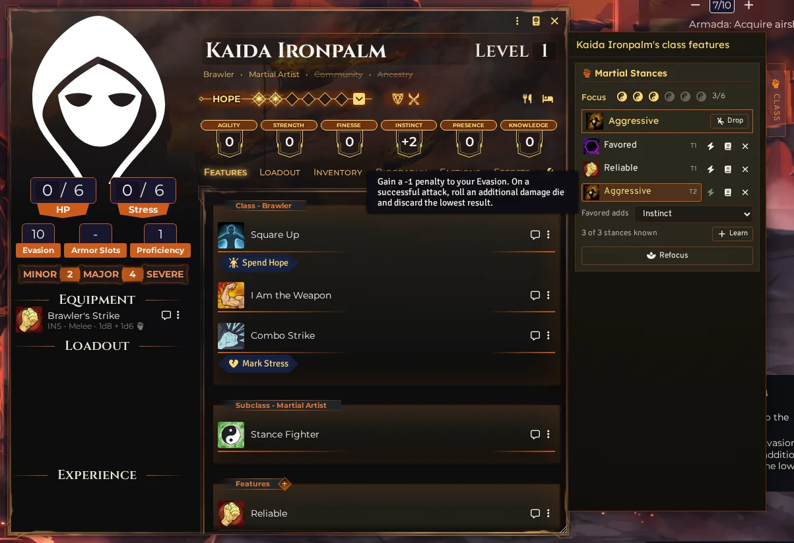
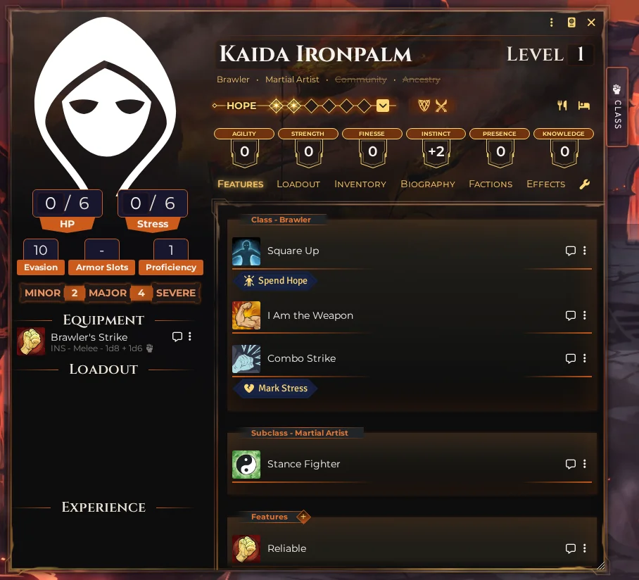
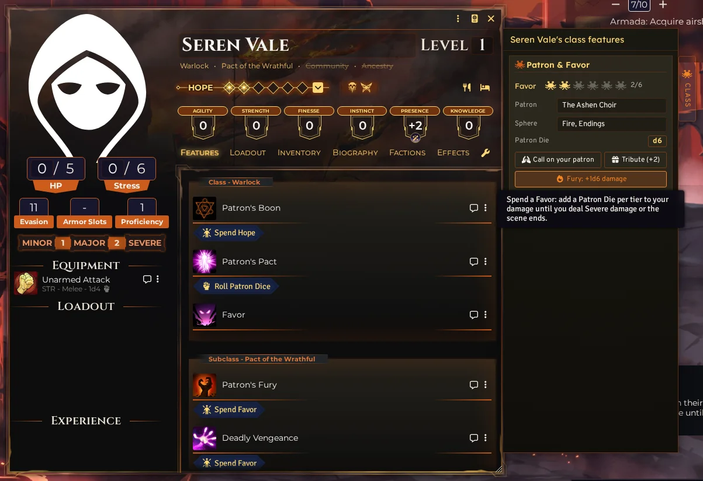
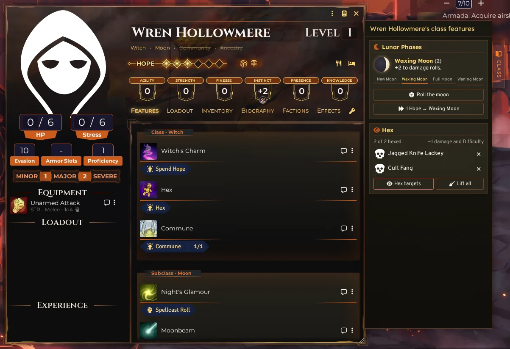
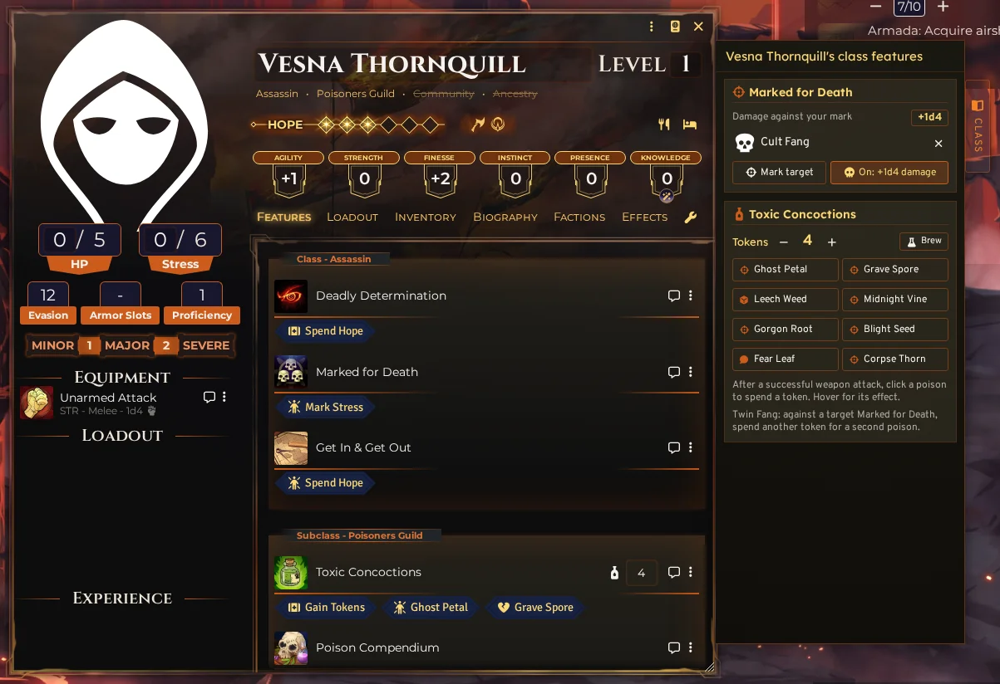

# Emberite Tweaks: Class Features

A Foundry VTT module for [Daggerheart](https://www.daggerheart.com) that automates class features the system leaves to the table. Character sheets get a **folder tab** on their edge. Pull it out and a drawer opens with a panel for each automated feature the character has: the Brawler's martial stances and Focus, the Warlock's Favor and Patron Die, the Witch's hexes and lunar phases, the Assassin's mark and poisons, and a few core class features. Characters without any of these features don't get the tab.

Every feature has its own switch in the module settings, so you can turn one off as soon as the system automates it itself.



## Requirements

- [**Foundry VTT**](https://foundryvtt.com/) v14
- [**Daggerheart**](https://foundryborne.online/) system 2.12 or later. The Hope & Fear classes, subclasses and martial stances come from the system's own compendiums.
- Optional: the [**Daggerheart Core Rulebook**](https://www.foundryvtt.store/products/daggerheart-core) module. The drawer takes its colours from the sheet, so it matches the Core Rulebook themes, including the campaign-frame themes from Hope & Fear and other modules, as well as the system's own sheet.

It works alongside the other emberite modules, including Five Banners' Factions tab.

## Installation

In Foundry's **Add-on Modules → Install Module**, paste this manifest URL:

```
https://github.com/emberite/dh-emberite-tweaks/releases/latest/download/module.json
```

## The drawer

The tab sits on the sheet's right edge and follows the window when you move, resize or minimise it. If the sheet is too close to the right side of the screen, the drawer opens on the left instead. Clicking the tab folds the drawer away; the next sheet you open remembers whether it was open. Only the character's owners and the GM see it.



## Features

### Brawler: Martial Stances (Martial Artist)

- **Focus track**: click a pip to set your Focus.
- **Known stances**, sorted by tier, with each stance's text as a tooltip. **Learn** lists the stances of your tier or lower from the system compendium and adds one with a click. The count shows how many you may know (two at level 1, one more each level).
- **Shift**: click a stance to spend a Focus and shift into it. With *Flow State* there's a ⚡ button that marks a Stress instead. A chat message shows the stance's text.
- **One active stance**: shifting drops the stance you were in. This also applies when a stance is entered through its own "Enter Stance" action on the sheet.
- **Dropping out**: you leave your stance automatically on Severe damage (3 or more Hit Points marked at once) or when you mark your last Hit Point. **Drop** leaves it by hand. Stances last a scene, so the system's end-of-scene refresh clears them as usual.
- **Favored** adds the trait you pick (Instinct until you choose). Changing the trait updates a running Favored stance.
- **Refocus**: rolls a d6 per point of Instinct and sets Focus to the highest result.

### Warlock: Patron & Favor



- **Favor track**, plus your **patron's name and sphere** saved on the character.
- **Patron Die** sized by level: d6, or d8 from level 5. (The system's own "Roll Patron Dice" action always rolls a d6.)
- **Call on your patron**: spends a Favor and adds the Patron Die to your **next action roll**. It shows in the roll dialog's effects and goes away after that roll.
- **Tribute** downtime move: gain Favor equal to your Spellcast trait.
- **Patron's Fury** (Pact of the Wrathful): spends a Favor and adds a Patron Die per tier to your damage rolls. It ends when you deal Severe damage or when the scene ends. The system's own "Spend Favor" action on the feature applies an effect with no bonus; the module replaces it with this one.

### Witch: Lunar Phases and Hex



- **Lunar Phases** (Moon): **Roll the moon** at the start of a session. The phase is set from the d6 and only the matching effect is turned on (Waxing +2 damage, Full +3 thresholds, Waning +1 Evasion; New Moon is a reminder). **1 Hope** advances the die, and a 6 becomes a 1. The effects also follow when you change the die on the sheet. Without the module, the pack's Waning effect is always on.
- **Hex**: lists the creatures on the scene you've hexed against your limit (your Spellcast trait), and shows the penalty (your tier). Click a name to ping its token, ✕ to lift the hex, or **Lift all**. **Hex targets** runs the feature's own action. You're warned when a new hex goes past your limit. Players can lift hexes from adversaries they don't own; the change goes through the GM, who must be connected.

### Assassin: Marked for Death and Toxic Concoctions



- **Marked for Death**: shows the creature you've marked and the right dice: tier × d4, d6 with *Ambush*, d8 with *Backstab*. **Striking the mark** adds those dice to your damage rolls while it's on, and turns itself off when no mark is left. Marking a new creature clears the old mark, because you can only have one.
- **Toxic Concoctions**: a token counter. **Brew** marks a Stress and adds 1d4+1 tokens. Each poison you know (including those from *Poison Compendium* and *Venomancer*) is a button that spends a token. Poisons the system has an action for are applied to your targets through that action. Leech Weed rolls its d6, and Fear Leaf posts its reminder.

### Core classes

- **Guardian: Unstoppable**: becoming Unstoppable puts the die on 1, sized d4, or d6 from level 5. Each damage roll that deals Hit Points raises it by one, and it ends Unstoppable once it would pass its maximum. The panel shows the die, with *Become Unstoppable* and *End* buttons.
- **Wizard: Strange Patterns**: pick your number from a list instead of rerolling the d12 on the sheet. The system already offers the Hope or Stress when the number comes up.

## Settings

Each feature has its own world setting, all on by default. Turn one off when the system starts doing the same thing:

- **Show the class features drawer** (per player): hides the tab. The automations keep working.
- **Brawler: Martial Stances**, **Brawler: one active stance**, **Brawler: drop stance on Severe damage**
- **Warlock: Favor and Patron Die**
- **Witch: Lunar Phases**, **Witch: Hex tracker**
- **Assassin: Marked for Death**, **Assassin: one mark at a time**, **Assassin: Toxic Concoctions**
- **Wizard: Strange Patterns number**
- **Guardian: Unstoppable**

Features are recognised by the system compendium item they came from, or by their English name, so they work whether they were added through a class or subclass, dragged from the compendium or copied.

Subclass features only count once the character has unlocked them, following the same rule the sheet uses: specialization features need the specialization and mastery features the mastery. A Moon witch gets the Lunar Phases panel at mastery, a Martial Artist the Flow State button at mastery, and an Executioner the Backstab d8s at mastery. Until then the module leaves those features alone.

## API

`game.modules.get('dh-emberite-tweaks').api` offers `toggleDrawer(actor, open)`, `refreshDrawers()`, `syncLunarEffects(item)`, the list of `panels` and the pure `rules` helpers.

## Development

- `scripts/rules.mjs` holds the rules and compendium ids with no Foundry dependencies. `npm test` runs `tests/rules.test.mjs` under Node.
- `scripts/drawer.mjs` is the drawer. Each panel in `scripts/panels/` exports `{ id, setting, icon, template, applies(actor), prepare(actor, state), actions }` and registers its own hooks.
- Releases are built by `.github/workflows/release.yml`. Publish a GitHub release tagged `vX.Y.Z`, and the workflow stamps the version and attaches `module.json` and `module.zip`.

## License

The Emberite Tweaks module (its code, templates and styles) is released under the [MIT License](LICENSE). © 2026 emberite.

The MIT License doesn't cover Daggerheart material. Rules text used here falls under the notice below. Class features, stances and their effects come from the Daggerheart system's compendiums and are not included in this repository.

This product includes materials from the
Daggerheart System Reference Document
2.0, © Critical Role, LLC. under the terms of
the Darrington Press Community Gaming
(DPCGL) License. More information can be
found at
https://www.daggerheart.com. There are
no previous modifications by others.
