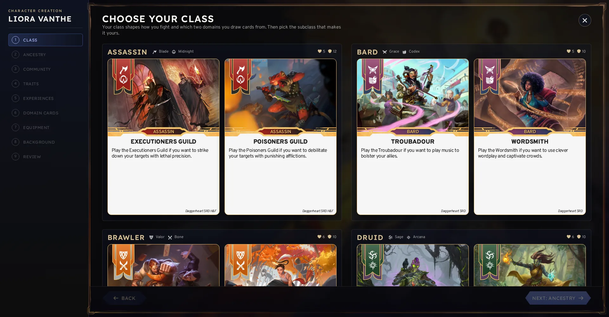
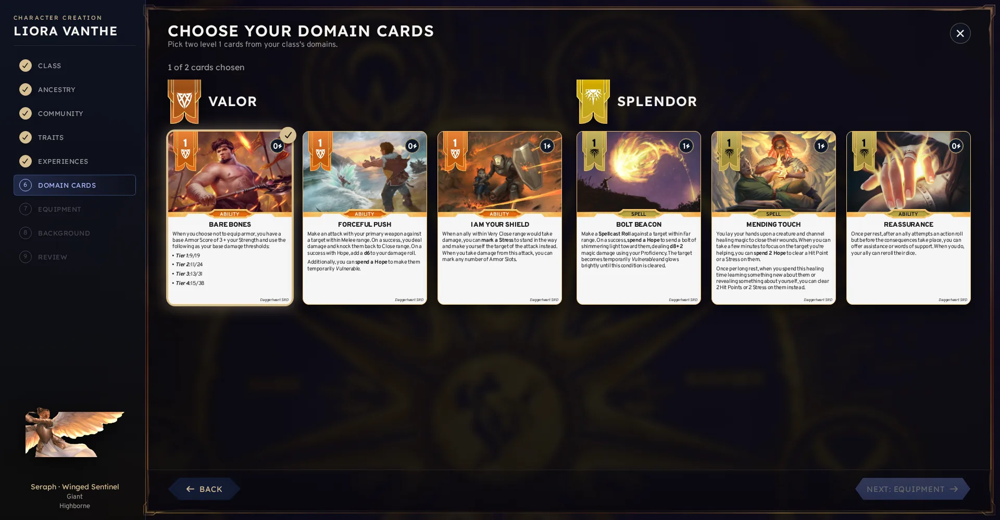
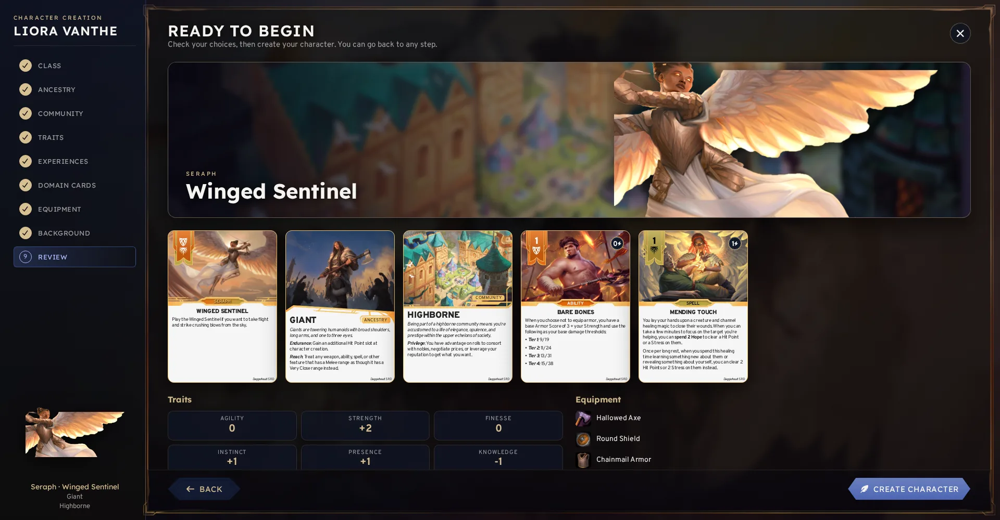
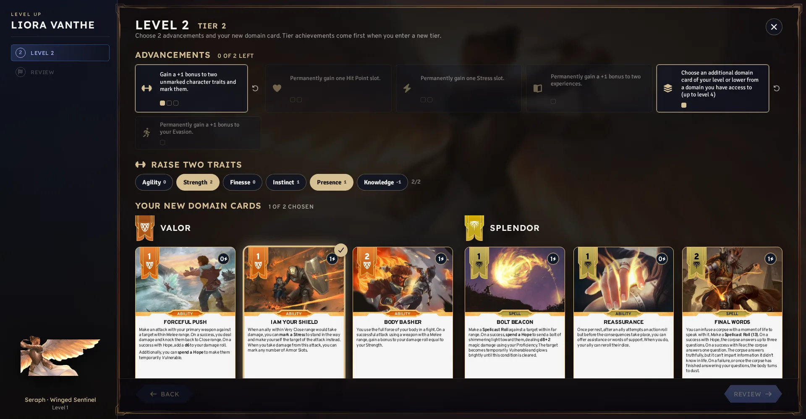
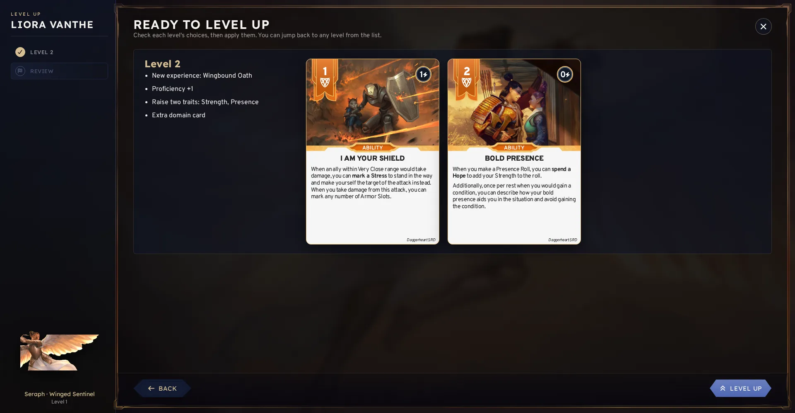
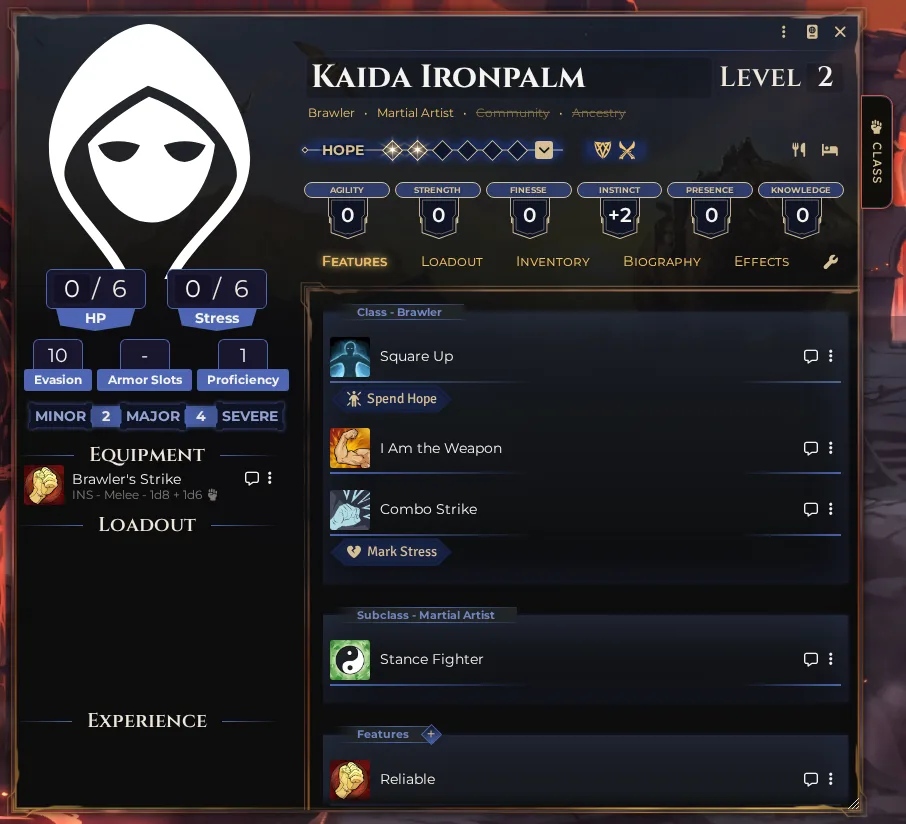
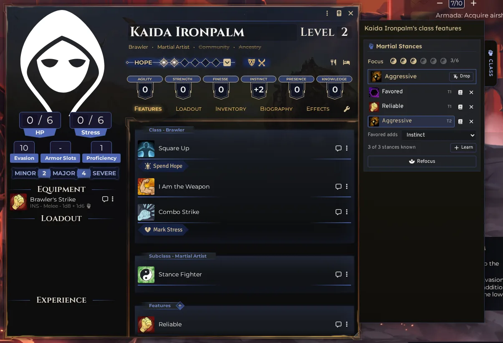
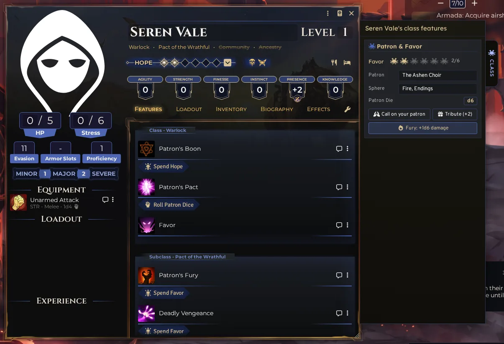
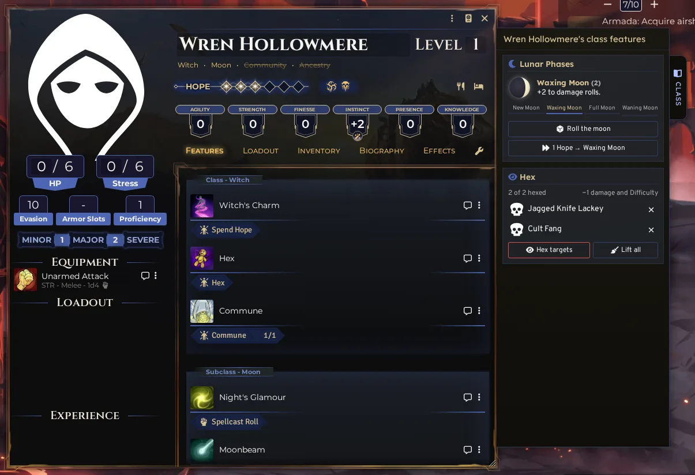
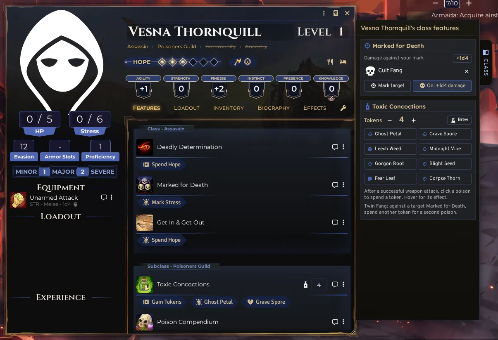

# Emberite Tweaks

A Foundry VTT module for [Daggerheart](https://www.daggerheart.com) with two tools:

- **Full-screen character creation and level up.** Build a character by clicking illustrated cards (class, subclass, ancestry, community, domain cards and gear) instead of dragging items into slots. Level up the same way. Both use the art of the Daggerheart premium modules and write the character with the system's own code.
- **A class features drawer.** Character sheets get a folder tab on their edge. Pull it out for a panel for each class feature the system leaves to the table: the Brawler's martial stances and Focus, the Warlock's Favor and Patron Die, the Witch's hexes and lunar phases, the Assassin's mark and poisons, and a few core class features.

Every tool and feature has its own switch in the module settings, so you can turn one off as soon as the system does the same thing.



## Requirements

- [**Foundry VTT**](https://foundryvtt.com/) v14
- [**Daggerheart**](https://foundryborne.online/) system 2.12 or later. The Hope & Fear classes, subclasses and martial stances come from the system's own compendiums.
- Recommended: the [**Daggerheart Core Rulebook**](https://www.foundryvtt.store/products/daggerheart-core) and **Daggerheart: Hope & Fear** modules. Their card art, class portraits, domain banners and splash art fill the creation and level-up screens, and the drawer takes its colours from their sheet themes. Without them, everything still works with the system's own icons and colours.

It works alongside the other emberite modules, including Five Banners' Factions tab.

## Installation

In Foundry's **Add-on Modules → Install Module**, paste this manifest URL:

```
https://github.com/emberite/dh-emberite-tweaks/releases/latest/download/module.json
```

## Character creation

When a new character's sheet shows **Character Setup**, it opens a full-screen wizard instead of the system's dialog. It wears the Daggerheart Core Rulebook module's sheet design (its theme colours and fonts, the wireframe frame and cut-corner buttons). Every choice is the system's own card, the same one its tooltips show, so you read the whole feature before you pick it. A list of steps runs down the left, with your character so far under it: your portrait if the character has one, otherwise your subclass's portrait.

1. **Class and subclass:** each class is a heading (with its domains, Hit Points and Evasion) over its two subclass cards. Pick a subclass card; that picks the class too.
2. **Ancestry:** turn on **mixed ancestry** to take the first feature from one ancestry and the second from another, and name the mix.
3. **Community.**
4. **Traits:** each trait gets one value from the trait array (+2, +1, +1, +0, +0, −1, or your homebrew array); used values grey out. One click fills in your class's suggestion.
5. **Experiences:** name two, each +2, with an optional description. Tab moves on to the next field.
6. **Domain cards:** two level 1 cards from your class's domains, under their domain banners.
7. **Equipment:** take the class's suggested kit, or **Choose my own** to pick tier 1 primary and secondary weapons and armor from a searchable gallery inside the wizard. Pick the class's "take one" items here too; your starting currency is listed.
8. **Background** (optional): pronouns, age and faith, answers to your class's background and connection questions, and questions of your own. They go into the biography with the answers under each question.
9. **Review:** your subclass in front of your community, and the cards you chose. **Create character** writes it.

You can go back to any finished step. The character is created by the system's own character creation code, so the items, features and links are exactly what the built-in dialog makes. The wizard lists every class, ancestry, community, domain card and piece of gear in the world and its compendiums, minus what the GM excluded in the system's compendium browser settings.





## Level up

The level up button opens a full-screen level up as well. If no level is pending, pick how far to go first; several levels at once is fine. Then, level by level:

- **Tier achievements** when you enter a new tier: name your new experience; Proficiency goes up by itself.
- **Advancements:** each option is a tile with its slots. Click to take one, ↺ to give it back. Options you've used up earlier in the tier are greyed out. Then make the follow-up choice right below: which two traits (traits raised earlier in the tier are locked), which experiences, which subclass to upgrade (its card shows what it unlocks), or a multiclass (other classes head their subclass cards, then pick the domain).
- **Your new domain cards** in one gallery: the level's card, plus one more if you took the extra domain card advancement. New cards go into your loadout while it has room (5 cards by default) and into the vault after that.

The review lists every level's choices next to the cards you chose, and **Level up** applies them with the system's own level-up code.





## Sheet sidebar

A separate tweak to the character sheet's sidebar, with its own switches:

- **Full-width resources:** Hit Points, Stress and Armor Slots each take a full-width row, marked with a heart, a bolt and a shield instead of text labels. It works with both of the system's displays (bars and slots). Armor keeps its gear button for armor management.
- **Current/max numbers** on those rows can be switched off; they then appear when you point at a row, so you can still type a value.
- **Evasion and Proficiency** get a slim row of their own under the portrait.
- **Loadout as a list:** the domain card loadout as rows in the Core Rulebook style (the domain's level banner, the card's art behind its name, a glow in the domain's colour) instead of a strip of card tiles.
- Clicking a domain card's **name** in the loadout uses it, like clicking its image.

### Chat themes

**Chat theme** puts chat messages in the Daggerheart Core Rulebook module's design, in the colours, fonts and faint cover art of one of its themes: the core theme or any campaign frame's (The Witherwild, Five Banners Burning, Beast Feast, The Age of Umbra, Motherboard, Colossus of the Drylands, and Hope & Fear's Castle High, Reign of the Weredragon, Dark Heart of Andaluria and Journey To Horizon). Rolls and the system's own chat cards follow the theme's colours. It reads the themes from the Core Rulebook module, so it needs that module, and themes other modules add to it show up too. Off by default.

**Frosted glass** turns chat messages into tinted, see-through glass that blurs what is behind them. The tint follows the chat theme (a cool grey with the theme off), so it works with or without the Core Rulebook module. Duality rolls get a glass of their own: gold with Hope, blue-violet with Fear, purple for a critical success. Off by default.

**Critical roll effect** marks critical successes (matching Hope and Fear dice, an adversary's natural 20) and critical damage in chat. Their card gets a gold edge that flares as it arrives, plus one of these effects:

- **Shine** (the default): a slow band of light sweeps across the card.
- **Embers:** glowing sparks rise from the bottom of the card and drift as they fade.
- **Sparkles:** small stars twinkle on and off across the card.
- **Pulsing glow:** the gold edge slowly brightens and dims.

The gold follows the chat theme. Nothing moves for users whose system asks for reduced motion.

### Fear tracker

The **Fear & Canvas** tab restyles the system's own Fear tracker for everyone at the table. Every option starts on **System**, which leaves the tracker as the system draws it, and the tab shows a live preview before you save.

- **Tracker style:** *Banner* draws the tokens as diamond pips on a dark bar with a gold rim and pointed ends, filled for each Fear the GM holds.
- **Token colours:** a palette (Crimson, Ember, Gold, Emerald, Frost, Violet, Rose, Shadow), or the colours of the Core Rulebook's core theme or any campaign frame, Hope & Fear's included. Frame colours are read from the Core Rulebook module, so they need it.
- **Token icon:** in place of the skull, a plain icon or one for each campaign frame (a leaf for The Witherwild, a flag for Five Banners Burning, a drumstick for Beast Feast, a ghost for The Age of Umbra, a microchip for Motherboard, a mountain for Colossus of the Drylands, a rook for Castle High, a dragon for Reign of the Weredragon, a heart for Dark Heart of Andaluria and a compass for Journey To Horizon).
- **Token shape:** squircle, square or diamond.
- **Glow at maximum Fear:** the tokens or bar pulse when Fear is full.

### Range band names

With **Name the range bands** on, the Daggerheart Core Rulebook module's range bands around a selected token get their names: Very Close, Close and Far just inside each ring, and Very Far just outside the last one. The names curve along the rings at the top, bottom and sides. They show and hide with the rings, following that module's own *Show Range Bands* setting, so the module is needed.

### Campaign frame

The **Campaign Frame** tab sets the frame this world is played in, from one list: the Core Rulebook's core theme or any campaign frame (Hope & Fear's included). The frame then drives every option with a frame-specific look, each behind its own switch:

- **Sheet theme:** sheets open in the frame's theme by default for every user. A theme someone picked for one particular sheet still wins.
- **Token ring:** Foundry's dynamic token ring becomes the frame's ring from the Core Rulebook or Hope & Fear module; a frame without a ring uses the core Daggerheart ring. Foundry loads rings with the world, so the GM is asked to reload everyone after a change.
- **Chat theme**, **Fear token colours** and **Fear token icon** take the frame's in place of their own choice. Those options show that the frame sets them, and their own choice comes back when you switch the frame off.

It reads the frames from the Core Rulebook module, so it needs that module.

### Spotlight and countdowns

- **Spotlight button on the Token HUD:** players ask for the spotlight, or stop asking, from their own token's HUD. In combat this is the same request as the combat tracker's hand button; outside combat it is saved on the character. The GM gives or takes the spotlight from any token's HUD with the system's own spotlight.
- **Show requests on the canvas:** the GM sees a small gold hand on the corner of every token asking for the spotlight.
- **Minimal countdowns:** while there are no countdowns, the GM's countdown panel shrinks to a small **+** that opens the system's countdown editor.

### Cards in chat

With **Chat: show cards as cards** on, domain cards, subclasses, ancestries and communities sent to chat show as their real card (the one the system's tooltips show), with the message's buttons below.

Right-click the subclass, ancestry or community under the character's name on the sheet to send its card to chat. A subclass that has reached specialization or mastery asks which card to send: foundation, specialization or mastery.

## Class features drawer

The tab sits on the sheet's right edge and follows the window when you move, resize or minimise it. If the sheet is too close to the right side of the screen, the drawer opens on the left instead. Clicking the tab folds the drawer away; the next sheet you open remembers whether it was open. Only the character's owners and the GM see it.



## Features

### Brawler: Martial Stances (Martial Artist)



- **Focus track**: click a pip to set your Focus.
- **Known stances**, sorted by tier, with each stance's text as a tooltip. **Learn** lists the stances of your tier or lower from the system compendium and adds one with a click. The count shows how many you may know (two at level 1, one more each level).
- **Shift**: click a stance to spend a Focus and shift into it. With *Flow State* there's a ⚡ button that marks a Stress instead. A chat message shows the stance's text.
- **One active stance**: shifting drops the stance you were in. This also applies when a stance is entered through its own "Enter Stance" action on the sheet.
- **Dropping out**: you leave your stance automatically on Severe damage (3 or more Hit Points marked at once) or when you mark your last Hit Point. **Drop** leaves it by hand. Stances last a scene, so the system's end-of-scene refresh clears them as usual.
- **Favored** adds the trait you pick (Instinct until you choose). Changing the trait updates a running Favored stance.
- **Refocus**: rolls a d6 per point of Instinct and sets Focus to the highest result.

### Warlock: Patron & Favor



- **Favor track**, plus your **patron's name and sphere** saved on the character.
- **Patron Die** sized by level: d6, or d8 from level 5. (The system's own "Roll Patron Dice" action always rolls a d6.)
- **Call on your patron**: spends a Favor and adds the Patron Die to your **next action roll**. It shows in the roll dialog's effects and goes away after that roll.
- **Tribute** downtime move: gain Favor equal to your Spellcast trait.
- **Patron's Fury** (Pact of the Wrathful): spends a Favor and adds a Patron Die per tier to your damage rolls. It ends when you deal Severe damage or when the scene ends. The system's own "Spend Favor" action on the feature applies an effect with no bonus; the module replaces it with this one.

### Witch: Lunar Phases and Hex



- **Lunar Phases** (Moon): **Roll the moon** at the start of a session. The phase is set from the d6 and only the matching effect is turned on (Waxing +2 damage, Full +3 thresholds, Waning +1 Evasion; New Moon is a reminder). **1 Hope** advances the die, and a 6 becomes a 1. The effects also follow when you change the die on the sheet. Without the module, the pack's Waning effect is always on.
- **Hex**: lists the creatures on the scene you've hexed against your limit (your Spellcast trait), and shows the penalty (your tier). Click a name to ping its token, ✕ to lift the hex, or **Lift all**. **Hex targets** runs the feature's own action. You're warned when a new hex goes past your limit. Players can lift hexes from adversaries they don't own; the change goes through the GM, who must be connected.

### Assassin: Marked for Death and Toxic Concoctions



- **Marked for Death**: shows the creature you've marked and the right dice: tier × d4, d6 with *Ambush*, d8 with *Backstab*. **Striking the mark** adds those dice to your damage rolls while it's on, and turns itself off when no mark is left. Marking a new creature clears the old mark, because you can only have one.
- **Toxic Concoctions**: a token counter. **Brew** marks a Stress and adds 1d4+1 tokens. Each poison you know (including those from *Poison Compendium* and *Venomancer*) is a button that spends a token. Poisons the system has an action for are applied to your targets through that action. Leech Weed rolls its d6, and Fear Leaf posts its reminder.

### Core classes

- **Guardian: Unstoppable**: becoming Unstoppable puts the die on 1, sized d4, or d6 from level 5. Each damage roll that deals Hit Points raises it by one, and it ends Unstoppable once it would pass its maximum. The panel shows the die, with *Become Unstoppable* and *End* buttons.
- **Wizard: Strange Patterns**: pick your number from a list instead of rerolling the d12 on the sheet. The system already offers the Hope or Stress when the number comes up.

## Settings

**Configure Settings → Emberite Tweaks → Open settings** opens one window with six tabs. Every option is an on/off switch or a choice with its explanation. Everything is on by default except the campaign frame, the chat theme, frosted glass and the Fear tracker's looks, which start off or on the system's own; turn one off when the system starts doing the same thing. Options that depend on another sit under it and grey out while it's off.

- **Wizards:** full-screen character creation; full-screen level up (off brings back the system's own dialogs).
- **Campaign Frame:** the world's campaign frame, and whether it sets the sheet theme, the chat theme, the Fear tokens' colours and icon, and the token ring.
- **Sheet & Chat:** full-width resources, show current/max numbers, loadout as a list; chat theme, frosted glass, critical roll effect, show cards as cards in chat, right-click to post subclass, ancestry and community.
- **Fear & Canvas:** the Fear tracker's style, token colours, icon and shape, and the glow at maximum Fear (with a live preview); range band names.
- **Spotlight:** the Token HUD spotlight button and its requests on the canvas; minimal countdowns.
- **Class Features:** show the class features drawer (each player decides for themselves), then each class's features: Brawler (Martial Stances panel, only one active stance, drop the stance on Severe damage), Warlock (Favor and Patron Die), Witch (Lunar Phases, Hex tracker), Assassin (Marked for Death, only one mark at a time, Toxic Concoctions), Guardian (Unstoppable Die), Wizard (Strange Patterns number).

All the looks are world options: the GM sets them once for everyone. Only the GM can change the world options; players see them and can change their own (the drawer).

Features are recognised by the system compendium item they came from, or by their English name, so they work whether they were added through a class or subclass, dragged from the compendium or copied.

Subclass features only count once the character has unlocked them, following the same rule the sheet uses: specialization features need the specialization and mastery features the mastery. A Moon witch gets the Lunar Phases panel at mastery, a Martial Artist the Flow State button at mastery, and an Executioner the Backstab d8s at mastery. Until then the module leaves those features alone.

## API

`game.modules.get('dh-emberite-tweaks').api` offers `openCreationWizard(actor)`, `openLevelUpWizard(actor)`, `toggleDrawer(actor, open)`, `refreshDrawers()`, `syncLunarEffects(item)`, the list of `panels` and the pure `rules` helpers.

## Development

- `scripts/rules.mjs` holds the rules and compendium ids with no Foundry dependencies. `npm test` runs `tests/rules.test.mjs` under Node.
- `scripts/wizard/` holds the full-screen creation (`wizard.mjs`) and level up (`levelup.mjs`). Both hand their result to the system's own code: `DhCharacterCreation.finish` and `actor.levelUp`. `art.mjs` maps the premium modules' art and only uses it while those modules are active.
- `scripts/drawer.mjs` is the drawer. Each panel in `scripts/panels/` exports `{ id, setting, icon, template, applies(actor), prepare(actor, state), actions }` and registers its own hooks.
- Releases are built by `.github/workflows/release.yml`. Publish a GitHub release tagged `vX.Y.Z`, and the workflow stamps the version and attaches `module.json` and `module.zip`.

## License

The Emberite Tweaks module (its code, templates and styles) is released under the [MIT License](LICENSE). © 2026 emberite.

The MIT License doesn't cover Daggerheart material. Rules text used here falls under the notice below. Class features, stances and their effects come from the Daggerheart system's compendiums and are not included in this repository.

This product includes materials from the
Daggerheart System Reference Document
2.0, © Critical Role, LLC. under the terms of
the Darrington Press Community Gaming
(DPCGL) License. More information can be
found at
https://www.daggerheart.com. There are
no previous modifications by others.
